# Campus Event Registration System (P3)
## Complete Project Blueprint, Architecture & Viva Preparation Guide

---

## 1. Project Overview & Problem Statement
* **Project Title:** Campus Event Registration System
* **Objective:** Build a web-based campus event portal displaying event details, total capacity, and real-time remaining seats. The platform allows students to register for events and cancel their registrations, while the backend strictly prevents duplicate entries and over-capacity registrations with dynamic seat counter updates.
* **Tech Stack:**
  - **Frontend:** HTML5, CSS3, JavaScript (Fetch API / AJAX)
  - **Backend:** PHP (using PDO for secure database access)
  - **Database:** MySQL / MariaDB (via XAMPP / phpMyAdmin)
  - **Local Server:** Apache (via XAMPP)

---

## 2. System Architecture & Request-Response Flow

```
+-------------------------------------------------------------+
|                 Student Browser (Frontend)                   |
|  - index.html (Event Cards, Modals, Forms)                  |
|  - style.css  (Modern UI, Responsive Layout)                |
|  - app.js     (AJAX fetch requests, UI updates without reload)|
+-------------------------------------------------------------+
                             ▲ |
              JSON Response  | | HTTP Fetch Requests
           (status, seats,   | | (register, cancel, get_events)
            error messages)  | ▼
+-------------------------------------------------------------+
|                     PHP Backend (XAMPP)                     |
|  - db.php                  -> Database connection (PDO)     |
|  - api/get_events.php      -> Returns events + live seats   |
|  - api/register.php        -> Validates, locks & registers  |
|  - api/cancel.php          -> Cancels registration          |
|  - api/my_registrations.php-> Returns student bookings      |
+-------------------------------------------------------------+
                             ▲ |
           SQL Results       | | Prepared SQL Queries
                             | ▼
+-------------------------------------------------------------+
|                    MySQL Database (phpMyAdmin)              |
|  - Table: events        (id, title, capacity, date, venue)  |
|  - Table: registrations (event_id, student_email, timestamp)|
|  - Unique Index prevents duplicate (event_id + student_email)|
+-------------------------------------------------------------+
```

---

## 3. Database Schema (With Passwordless OTP Authentication)

To ensure complete data integrity, identity verification, and prevent malicious cancellations, we use **4 clean relational tables**:

### Table 1: `events`
Stores campus event details and max capacity.
| Column | Type | Description |
| :--- | :--- | :--- |
| `id` | `INT AUTO_INCREMENT PRIMARY KEY` | Unique event ID |
| `title` | `VARCHAR(150)` | Name of the event (e.g., "Hackathon 2026") |
| `category` | `VARCHAR(50)` | Tech, Cultural, Sports, Workshop, Career |
| `description` | `TEXT` | Event overview and details |
| `event_date` | `DATETIME` | Scheduled date and time |
| `venue` | `VARCHAR(100)` | Location (e.g., "Auditorium Hall B") |
| `capacity` | `INT` | Total maximum allowed registrations |
| `created_at` | `TIMESTAMP DEFAULT CURRENT_TIMESTAMP` | Record creation time |

### Table 2: `users` (Students)
Stores verified student profiles.
| Column | Type | Description |
| :--- | :--- | :--- |
| `id` | `INT AUTO_INCREMENT PRIMARY KEY` | Unique student user ID |
| `name` | `VARCHAR(100)` | Student's full name |
| `student_id` | `VARCHAR(50) UNIQUE` | College Roll No / Student ID |
| `email` | `VARCHAR(100) UNIQUE` | Student college email |
| `created_at` | `TIMESTAMP DEFAULT CURRENT_TIMESTAMP` | Account creation time |

### Table 3: `email_otps` (Passwordless Authentication)
Stores time-limited 6-digit verification codes.
| Column | Type | Description |
| :--- | :--- | :--- |
| `id` | `INT AUTO_INCREMENT PRIMARY KEY` | Unique OTP record ID |
| `email` | `VARCHAR(100)` | Student email receiving the code |
| `otp_code` | `VARCHAR(6)` | 6-digit numeric verification code |
| `expires_at`| `DATETIME` | Timestamp when OTP expires (5 minutes) |
| `is_used` | `TINYINT DEFAULT 0` | Set to 1 once consumed |

### Table 4: `registrations`
Links an authenticated student to an event.
| Column | Type | Description |
| :--- | :--- | :--- |
| `id` | `INT AUTO_INCREMENT PRIMARY KEY` | Unique registration ID |
| `event_id` | `INT` | Foreign Key referencing `events(id)` |
| `user_id` | `INT` | Foreign Key referencing `users(id)` |
| `registered_at`| `TIMESTAMP DEFAULT CURRENT_TIMESTAMP` | Time of registration |

### Crucial SQL Constraint (The Secret to Preventing Duplicates)
```sql
ALTER TABLE registrations 
ADD CONSTRAINT unique_user_event 
UNIQUE (event_id, user_id);
```
> **Why this matters for your viva:** At the database level, `(event_id, user_id)` is guaranteed to be unique. A student cannot register for the same event twice under any circumstance.


---

## 4. How Each Core Requirement Functions

### A. Dynamic Remaining Seats
* **Calculation:** 
  $$\text{Remaining Seats} = \text{Total Capacity} - \text{Total Registrations for this Event}$$
* **Dynamic Update Mechanism:**
  When a user registers or cancels, JavaScript calls the backend using `fetch()`. The backend returns the updated seat count in JSON, and JavaScript immediately updates the text on the card (e.g., from `12 seats left` to `11 seats left`) without reloading the webpage.

### B. Prevention of Duplicate Registrations
* **Double-Layer Protection:**
  1. **PHP Check:** Before inserting, PHP runs a query:
     `SELECT id FROM registrations WHERE event_id = ? AND student_email = ?`
     If a record exists, it immediately returns: `{"status": "error", "message": "You are already registered for this event."}`
  2. **Database Constraint:** The `UNIQUE(event_id, student_email)` key serves as a hardware-level safety net.

### C. Prevention of Over-Capacity Registrations (Race Conditions)
* **The Problem:** If only 1 seat is left, and 2 students submit at the exact same millisecond, both might get in unless controlled.
* **The Solution:** 
  In `register.php`, we use a **Database Transaction**:
  1. `BEGIN TRANSACTION`
  2. Count current registrations for the event:
     `SELECT COUNT(*) FROM registrations WHERE event_id = ? FOR UPDATE`
  3. Compare with event capacity. If `current >= capacity`, trigger `ROLLBACK` and return: `{"status": "error", "message": "Event is fully booked!"}`
  4. If seats are available, `INSERT` the registration and `COMMIT`.

### D. Registration & Cancellation
* **Registration:** Student selects an event, enters their Name, Roll Number, and Email, and clicks "Confirm Registration".
* **Cancellation:** Student can view "My Bookings" by entering their email, view all events they are registered for, and click "Cancel Registration". This deletes the registration record and instantly increments the remaining seats.

---

## 5. Feature List

### Core Features (Must-Haves)
1. **Event Showcase Grid:** Clean, attractive cards displaying event banner, title, date, venue, category badge, and seat meter.
2. **Real-Time Seat Indicators:**
   - Visual badges: *Green (Available)*, *Orange (Filling Fast < 5 seats)*, *Red (Sold Out / Full)*.
   - Progress bar showing percentage filled.
3. **Registration Modal:** Pop-up form requesting Name, Student ID, and Email.
4. **My Bookings / Cancellation Portal:** Allows students to view active registrations and cancel them with one click.
5. **Instant Toast Alerts:** Smooth pop-up notifications (e.g., "Registration Successful!", "Already registered!", "Seats full!").

### Added Value / Presentation Polish
* Search bar to filter events by name.
* Category filter tabs (All, Tech, Cultural, Sports, Workshops).

---

## 6. Detailed Phase-by-Phase Implementation Plan

```mermaid
gantt
    title Step-by-Step Implementation Plan
    dateFormat  X
    axisFormat %s
    section Phase 1: Database Setup
    Configure XAMPP & run schema.sql :active, 0, 1
    Insert realistic sample events with capacities : 1, 2
    section Phase 2: Core DB Connection
    Create api/db.php using PDO : 2, 3
    section Phase 3: Backend REST APIs
    Build api/get_events.php : 3, 4
    Build api/register.php (with Concurrency Lock) : 4, 5
    Build api/cancel.php & api/my_registrations.php : 5, 6
    section Phase 4: Frontend UI
    Build index.html (semantic layout & modals) : 6, 7
    Build css/style.css (modern, responsive portal) : 7, 8
    section Phase 5: Dynamic JavaScript
    Build js/app.js (Fetch API & DOM updates) : 8, 9
    section Phase 6: Testing & Viva Prep
    Simulate duplicates, capacity limits & cancellations : 9, 10
```



---

### Phase 1: Database Setup & Configuration
* **Goal:** Initialize the database on MySQL/MariaDB inside XAMPP with proper constraints and sample data.
* **Files Created:**
  - `database/schema.sql`
* **Step-by-Step Tasks:**
  1. Open XAMPP Control Panel and click **Start** on both **Apache** and **MySQL**.
  2. Open browser and visit `http://localhost/phpmyadmin`.
  3. Create a new database named `campus_events`.
  4. Run `database/schema.sql` to create:
     - `events` table (includes `capacity`, `title`, `venue`, `event_date`, `category`).
     - `registrations` table (with `UNIQUE KEY(event_id, student_email)`).
  5. Seed 5 realistic campus events (e.g., *AI & Web3 Hackathon (Capacity: 50)*, *Robotics Workshop (Capacity: 3)*, *Annual Cultural Fest (Capacity: 100)*).
* **How to Verify This Phase:**
  - In phpMyAdmin, browse the `events` table and confirm the 5 rows are visible.
* **Viva Checkpoint:**
  > *Why put `UNIQUE(event_id, student_email)` at the database level?*
  > Even if two browser requests hit the server at the exact same millisecond, the database engine itself guarantees that a duplicate row cannot be created.

---

### Phase 2: Secure Database Connection (`db.php`)
* **Goal:** Establish a single, reusable PDO database connection object for all PHP endpoints.
* **Files Created:**
  - `api/db.php`
* **Step-by-Step Tasks:**
  1. Configure connection constants:
     - Host: `localhost`
     - Database: `campus_events`
     - Username: `root`
     - Password: `""` (default XAMPP password)
     - Charset: `utf8mb4`
  2. Instantiate `new PDO()` with options:
     - `PDO::ATTR_ERRMODE => PDO::ERRMODE_EXCEPTION` (throws readable errors if queries fail).
     - `PDO::ATTR_DEFAULT_FETCH_MODE => PDO::FETCH_ASSOC` (returns clean associative arrays).
  3. Set header `header('Content-Type: application/json; charset=UTF-8')`.
* **How to Verify This Phase:**
  - Visiting `http://localhost/WEB%20DEV%20PROJECT/api/db.php` in the browser returns a blank page with no errors or a simple `{ "status": "connected" }` test message.
* **Viva Checkpoint:**
  > *Why PDO instead of mysqli?*
  > PDO works across multiple database types, enforces prepared statements natively, and provides cleaner transaction handling.

---

### Phase 3: Backend REST API Endpoints
* **Goal:** Build the server endpoints that receive requests from the frontend and send back JSON responses.
* **Files Created:**
  - `api/get_events.php`
  - `api/register.php`
  - `api/cancel.php`
  - `api/my_registrations.php`
* **Step-by-Step Tasks:**
  1. **`api/get_events.php`**:
     - Executes SQL query that dynamically calculates remaining seats:
       ```sql
       SELECT e.*, 
              (e.capacity - COUNT(r.id)) AS remaining_seats
       FROM events e
       LEFT JOIN registrations r ON e.id = r.event_id
       GROUP BY e.id
       ORDER BY e.event_date ASC;
       ```
     - Returns JSON array of all events with live `remaining_seats`.
  2. **`api/register.php`**:
     - Reads JSON POST payload (`event_id`, `student_name`, `student_id`, `student_email`).
     - Validates that inputs are not empty and email is valid.
     - Starts transaction: `$pdo->beginTransaction()`.
     - **Check 1 (Duplicate):** `SELECT id FROM registrations WHERE event_id = ? AND student_email = ?`. If found, roll back and return error: *"You are already registered for this event."*
     - **Check 2 (Capacity Lock):** 
       `SELECT capacity, (SELECT COUNT(*) FROM registrations WHERE event_id = ?) AS current_count FROM events WHERE id = ? FOR UPDATE`.
       If `current_count >= capacity`, roll back and return error: *"Sorry, this event is fully booked!"*
     - **Insert:** If both checks pass, `INSERT INTO registrations ...` and `$pdo->commit()`.
     - Returns JSON: `{"success": true, "message": "Registered successfully!", "new_remaining": X}`.
  3. **`api/cancel.php`**:
     - Receives `registration_id` and student email.
     - Deletes the record: `DELETE FROM registrations WHERE id = ? AND student_email = ?`.
     - Returns JSON: `{"success": true, "message": "Registration cancelled successfully."}`.
  4. **`api/my_registrations.php`**:
     - Receives `email` via GET query parameter.
     - Returns list of events the student is currently registered for with date and venue.
* **How to Verify This Phase:**
  - Open `api/get_events.php` in the browser and confirm it outputs valid JSON containing events and `remaining_seats`.
* **Viva Checkpoint:**
  > *What does `FOR UPDATE` do in the SQL query?*
  > It locks the selected rows until the transaction finishes. This prevents two concurrent users from reading the last available seat simultaneously.

---

### Phase 4: Frontend UI (HTML5 & Modern CSS)
* **Goal:** Create an attractive, modern, and intuitive campus event portal.
* **Files Created:**
  - `index.html`
  - `css/style.css`
* **Step-by-Step Tasks:**
  1. **Structure (`index.html`)**:
     - **Navbar:** Brand title ("CampusEvents"), category filter pills (*All, Tech, Workshop, Cultural, Sports*), search input, and a "My Bookings" button.
     - **Hero Section:** Campus banner welcoming students with a quick counter of total events and open seats.
     - **Events Grid:** Container `<div id="events-grid">` populated dynamically via JavaScript.
     - **Registration Modal:** Pop-up dialog with event title, remaining seats badge, and input fields (Full Name, Student Roll No, Email).
     - **My Bookings Modal:** Pop-up dialog allowing students to enter their email to view their active registrations and cancel them.
     - **Toast Alert Container:** Container for animated feedback messages.
  2. **Styling (`css/style.css`)**:
     - Professional design tokens (curated indigo/violet palette, smooth gradients, Inter typography).
     - Responsive grid layout (3 columns on desktop, 2 on tablet, 1 on mobile).
     - Event Cards: Includes category badge, event title, date/time icon, venue icon, capacity progress bar.
     - Dynamic Status Badges:
       - Green badge: `> 5 seats available`
       - Orange badge: `< 5 seats left (Filling Fast)`
       - Red badge: `0 seats left (Full / Housefull)` -> Registration button automatically disabled.
     - Glassmorphism modal styling with smooth backdrop blur.
* **How to Verify This Phase:**
  - Open `index.html` in browser; verify that modals open/close cleanly and that card layouts adapt smoothly across window sizes.
* **Viva Checkpoint:**
  > *Why use semantic HTML elements like `<header>`, `<main>`, `<dialog>`/modal?*
  > Semantic HTML improves accessibility, SEO, maintainability, and code structure.

---

### Phase 5: Dynamic JavaScript Integration (AJAX / Fetch API)
* **Goal:** Connect frontend interactions to backend APIs seamlessly with zero full-page reloads.
* **Files Created:**
  - `js/app.js`
* **Step-by-Step Tasks:**
  1. **`fetchEvents()`**:
     - Calls `api/get_events.php` asynchronously on page load.
     - Renders event cards into the DOM.
     - Updates the seat counters and capacity progress bars.
     - Disables the "Register" button if `remaining_seats <= 0`.
  2. **`submitRegistration(event)`**:
     - Intercepts form submission (`e.preventDefault()`).
     - Sends student details to `api/register.php` via `fetch()` POST.
     - On success: Closes modal, displays green toast alert, and updates the remaining seat count on that specific event card in real-time.
     - On failure (duplicate or full): Displays yellow/red toast alert with the exact server error message.
  3. **`viewMyRegistrations()` & `cancelRegistration(regId, eventId)`**:
     - Prompts student for email, fetches active registrations from `api/my_registrations.php`.
     - Displays registered events with a "Cancel" button.
     - Clicking "Cancel" calls `api/cancel.php`, removes the booking, and automatically increments the remaining seats on the main event card.
  4. **Live Search & Category Filtering**:
     - Filters cards in real-time as the user types in the search bar or clicks category tabs without touching the database.
* **How to Verify This Phase:**
  - Register for an event -> Watch the remaining seats counter drop by 1 instantly on the card.
  - Try registering again with the same email -> Verify warning message appears: "You are already registered".
  - Cancel the registration -> Watch the remaining seats counter increment back by 1 instantly.
* **Viva Checkpoint:**
  > *What is the difference between synchronous form submission and Fetch API?*
  > Synchronous form submission causes the browser to reload the entire HTML page. Fetch API sends an asynchronous HTTP request in the background and updates only the necessary DOM elements using JavaScript.

---

### Phase 6: Edge Case Testing & Viva Demonstration Preparation
* **Goal:** Verify that all problem statement constraints are strictly enforced and prepare for examiner questions.
* **Test Scenarios to Demonstrate in Viva:**
  1. **Zero-Capacity Handling:** Set an event's capacity to 1 in the database. Register one user. Verify the card immediately turns red ("Housefull"), and the register button is disabled.
  2. **Duplicate Registration Check:** Attempt to register with the same email for the same event; confirm server rejects it with an informative message.
  3. **Seat Reclamation:** Cancel the registration and demonstrate that the seat is immediately available again.
  4. **SQL Injection Security:** Enter `' OR 1=1 --` in the email input to demonstrate that PDO prepared statements treat it safely as a plain literal string.

---

## 7. Viva Preparation: Questions & Clear Answers

#### Q1: Which database did you use and why?
> **Answer:** "We used **MySQL** via XAMPP. It is a relational database management system (RDBMS) that provides ACID transactions and constraints like `FOREIGN KEY` and `UNIQUE`, which are required to enforce data integrity and prevent duplicate registrations."

#### Q2: How does the server prevent duplicate registrations?
> **Answer:** "We implemented dual-layer prevention:
> 1. At the application layer: `register.php` checks if the student's email is already registered for that event ID.
> 2. At the database layer: We defined a composite `UNIQUE (event_id, student_email)` index, ensuring the database physically rejects any duplicate entry."

#### Q3: How do you prevent over-capacity registrations if multiple users click at once?
> **Answer:** "We handle this inside `register.php` using a database transaction with row-level locking (`FOR UPDATE`). The script checks the current count of registrations against the event capacity within the transaction. If count reaches capacity, the transaction rolls back and rejects the request."

#### Q4: What makes the remaining seats update 'dynamically'?
> **Answer:** "Instead of performing standard full-page form submissions that reload the page, we use JavaScript's **Fetch API (AJAX)**. When a student registers or cancels, an asynchronous HTTP request is sent in the background. The server returns JSON with the new seat count, and JavaScript updates only that specific card's DOM element instantly."

#### Q5: Why did you choose PDO over `mysqli` in PHP?
> **Answer:** "PDO (PHP Data Objects) supports prepared statements with parameter binding, which completely eliminates SQL Injection vulnerabilities. It also has clean transaction handling (`beginTransaction`, `commit`, `rollBack`) and unified error handling via exceptions."

#### Q6: What happens when a user cancels a registration?
> **Answer:** "The record is removed from the `registrations` table. Because remaining seats are calculated as `capacity - COUNT(registrations)`, removing the record automatically increments the available seat count on the next query."

---

## 8. Directory Structure to Build

```
WEB DEV PROJECT/
│
├── PROJECT_GUIDE.md             <-- This guide
├── index.html                   <-- Main campus event portal
├── css/
│   └── style.css                <-- Modern responsive styles
├── js/
│   └── app.js                   <-- Frontend logic & AJAX dynamic updates
├── api/
│   ├── db.php                   <-- Database PDO connection
│   ├── get_events.php           <-- API: Fetch events with remaining seats
│   ├── register.php             <-- API: Handle registration with validation
│   ├── cancel.php               <-- API: Cancel registration
│   └── my_registrations.php     <-- API: Retrieve registrations for an email
└── database/
    └── schema.sql               <-- SQL schema + sample data
```
